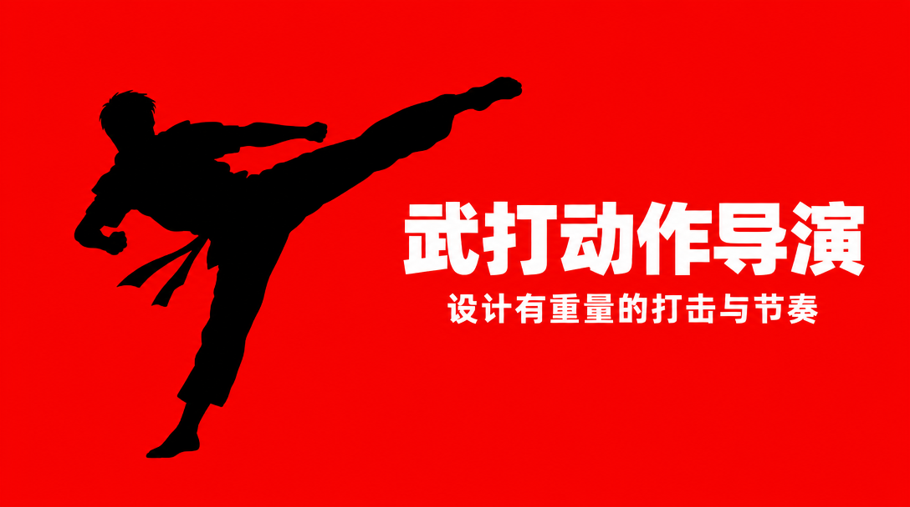
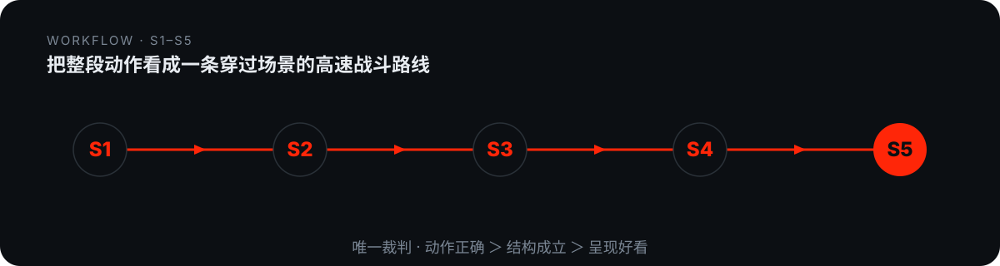

# domn-film-action-director



> 为 AI 视频生成或补强打戏/武打/战斗分镜提示词，并诊断「发飘/不丝滑/没打击感」等病症给出改写稿。

## 真实产出样例

下面是这个技能**实际会产出**的东西（抽自仓库内的 references/ 真实交付样例），不是抽象描述：

```text
路线：近岸石阶(起点) ──蹬壁跃起──→ 檐顶(中距) ──错身掠过──→ 庭院纵深
      ──被轰穿照壁──→ 后院水畔(终结落点，离起点最远)
回合：R1 1-3.5s | R2 3.5-6s | R3 6-9s | R4 9-13s | 终结 13-15s
重击：较早重击 @6.5s（撞穿照壁，沿飞行线犁开）| 终结重击 @13-15s（水面终结帧）
跳位三连：〔贴脸·右·低位〕→〔全景·左·檐顶〕→〔中景·正面·水畔〕
怼脸弹射：@3.5s / @9s（换侧、换仰角，不复用正面首帧）
```

## 是什么

为 AI 视频生成或补强打戏/武打/战斗分镜提示词，并诊断「发飘/不丝滑/没打击感」等病症给出改写稿。 本仓库是一个 Agent 技能（SKILL.md 为唯一权威定义），把上面的方法论沉淀为可被对话触发的可执行流程。

## 为什么不同

用「动作层>结构层>呈现层」三层架构定位翻车点，立 10 条铁律当唯一裁判——任何花哨运镜都救不了一条接不上的打斗，必须先让打斗成立再让它燃。

## 怎么做（工作流）

<p align="center">
  
</p>

> 唯一裁判：动作层正确 > 结构层成立 > 呈现层好看

1. **看清角色与场景** — 锁定外形/服装/武器/体型，以及战场/天气/建筑/介质
2. **定专属打法** — 为每个角色设计一套选择动作的方法，而非一组招牌动作
3. **铺整场路线** — 把整段看成一条穿过场景的高速战斗路线：从哪打到哪、在哪终结
4. **排回合重击** — 回合单元 + 两次重击 + 终结帧
5. **成稿** — 动作与切镜先完成，秒数最后填；只写摄像机能拍到的

## 怎么用

将本仓库放入支持 `SKILL.md` 的 Agent 技能目录：

- **WorkBuddy**：`~/.workbuddy/skills/domn-film-action-director/`
- **Codex / 其他**：对应 skills 目录

然后在对话中触发，例如：

```
用 domn-film-action-director 给我写一段 30 秒的巷战打戏分镜提示词，主角用长刀，要求重击三档 + 终结帧。
```

## 依赖

纯提示词方法论 + references/ 弹药库；生视频依赖文生视频模型（即梦 Seedance / Kling / 可灵等），提示词喂给这些模型执行。

## 仓库结构

```
domn-film-action-director/
├── SKILL.md                 # 技能定义（唯一权威）
├── assets/                  # 模板 / 占位素材
├── references/              # 方法论弹药库
└── assets/readme/           # 本 README 的视觉资产（hero.webp / workflow.svg）
```

## 许可

本仓库内容以 `SKILL.md` 为唯一权威定义。如附带 `LICENSE` 文件，以其为准。

---

*README 由 `beautify-github-readme` 生成 · 封面图来自作者作品集，强调色由封面采样派生；工作流图为每技能独立 motif。*